# ShopSphere: Online Shopping Funnel Analysis

**An e-commerce database that tracks every step a shopper takes, from viewing a product to paying and reviewing it, and shows where customers drop off.**

Course project for **22AIE303 Database Management Systems**, built with MySQL 8 and Django.

- GitHub repository: <https://github.com/Bhavesh-max-jpj/E-commerce-project>
- Full report: [docs/ShopSphere_DBMS_Project_Report.pdf](docs/ShopSphere_DBMS_Project_Report.pdf)

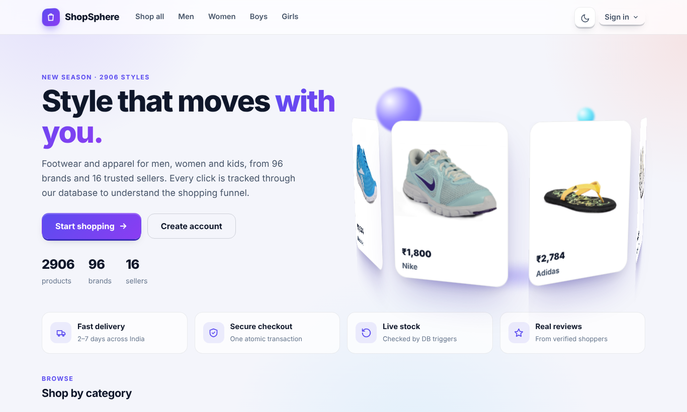

---

## Contents

1. [Team members](#1-team-members)
2. [Introduction and problem statement](#2-introduction-and-problem-statement)
3. [System requirements and architecture](#3-system-requirements-and-architecture)
4. [Conceptual and logical database design](#4-conceptual-and-logical-database-design)
5. [ER diagram and UML diagrams](#5-er-diagram-and-uml-diagrams)
6. [Relational schema mapping](#6-relational-schema-mapping)
7. [Normalization and functional dependencies](#7-normalization-and-functional-dependencies)
8. [Methodology](#8-methodology)
9. [Advanced SQL: constraints, triggers, views, procedures, transactions](#9-advanced-sql-constraints-triggers-views-procedures-transactions)
10. [Complex queries and their purpose](#10-complex-queries-and-their-purpose)
11. [Repository structure](#11-repository-structure)
12. [Installation and setup](#12-installation-and-setup)
13. [Running the application](#13-running-the-application)
14. [Demonstration: reproduce the database state and results](#14-demonstration-reproduce-the-database-state-and-results)
15. [Testing and validation](#15-testing-and-validation)
16. [Screenshots and sample outputs](#16-screenshots-and-sample-outputs)
17. [Conclusion and future scope](#17-conclusion-and-future-scope)

---

## 1. Team members

| # | Name | Roll number |
|---|---|---|
| 1 | Nagireddy Bhavesh Reddy | CB.SC.U4AIE24034 |
| 2 | Bachu Harini | CB.SC.U4AIE24010 |
| 3 | Kallam Pratheep Reddy | CB.SC.U4AIE24021 |
| 4 | Ravala Gnanasri | CB.SC.U4AIE24064 |

---

## 2. Introduction and problem statement

ShopSphere is an online clothing and footwear store. Its database (`shopping_funnel`) holds **2,905 products from 16 sellers**, taken from a real fashion catalogue with product photos, together with customers, carts, orders, payments and reviews.

**Problem.** A shop knows how many orders it gets, but not how many people looked and left. Without knowing *where* shoppers are lost (after viewing, in the cart, at payment) it cannot fix the right step.

**Objectives.**

- Record each customer action as a funnel stage: **VIEW → CART → CHECKOUT → ORDER → PAYMENT → REVIEW**.
- Compute the conversion rate and drop-off between stages, overall and per product, category, brand, seller, device and day.
- Keep the data correct inside the database itself, using keys, constraints, triggers and transactions, so the rules hold whichever program writes to it.
- Give three kinds of users their own interface:
  - **customers** shop;
  - **sellers** manage their products and see their sales;
  - **admins** manage the store and read the funnel analytics.

**Formulas.**

- Conversion rate (stage *k*) = customers at stage *k* ÷ customers at stage *k − 1* × 100
- Drop-off rate (stage *k*) = 100 − conversion rate
- Overall conversion = customers who paid ÷ customers who viewed × 100

**Main finding on the demo data.** About 57% of visitors add something to the cart. On mobile only about 44% of carts become orders, against about 60% on desktop, so mobile checkout is the weakest step.

---

## 3. System requirements and architecture

### Requirements

| Software | Version |
|---|---|
| Python | 3.10 or newer (developed on 3.12) |
| MySQL Server + MySQL Workbench | 8.0 (developed on 8.0.46) |
| Django | 5.2 or 6.x (see `requirements.txt`) |
| PyMySQL | 1.1 or newer |
| Browser | Chrome, Edge or Firefox |

Hardware: any laptop that runs MySQL 8. The database is about 5 MB; the product photos in `datasets/` are about 370 MB.

### Architecture

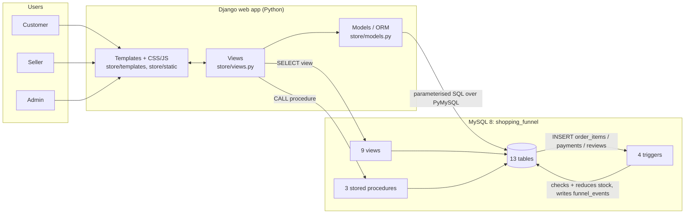

- **Frontend.**
  - HTML templates with hand-written CSS (3D cards, dark mode) and JavaScript.
  - Chart.js is bundled locally, so the charts work offline.
- **Backend.**
  - Django (Python) with the PyMySQL driver.
  - All data access goes through the Django ORM or `cursor.execute(sql, params)` with `%s` placeholders. User input is never pasted into SQL, which prevents SQL injection.
  - Each connection is reused for up to 5 minutes (`CONN_MAX_AGE`, Django's form of connection pooling for MySQL) and health-checked before reuse.
- **Database.**
  - Stock, funnel stages and data rules are enforced inside MySQL by constraints and triggers.
  - Reports come from views and stored procedures.

---

## 4. Conceptual and logical database design

The conceptual model has **13 entities** in four groups. Each entity maps to exactly one table, and each one-to-many relationship becomes a foreign key on the "many" side.

| Group | Entity | Description | Identifier |
|---|---|---|---|
| Catalogue | Seller | A business that lists products | seller_id |
| Catalogue | Product | One item for sale, with price and stock | product_id |
| People | Customer | A registered shopper | customer_id |
| People | Admin | A store administrator | admin_id |
| Sales | Cart | A product waiting in a customer's cart | cart_id |
| Sales | Order | One purchase by a customer | order_id |
| Sales | Order item | One product line within an order (weak entity of Order) | order_item_id |
| Sales | Payment | A payment attempt for an order | payment_id |
| Sales | Review | A customer's rating of a product | review_id |
| Behaviour | User session | One login visit, with device type | session_id |
| Behaviour | Product view | A product page opened in a session | view_id |
| Behaviour | Cart event | A change to a cart (add, increase, decrease, remove) | event_id |
| Behaviour | Funnel event | A customer reaching a funnel stage | event_id |

**Relationships and cardinalities**

| Relationship | Cardinality | Notes |
|---|---|---|
| Seller *lists* Product | 1 : N | A product's seller is optional |
| Customer *places* Order | 1 : N | Every order has exactly one customer |
| Order *contains* Product, through Order item | M : N | An order has at least one item |
| Order *is paid by* Payment | 1 : N | Failed attempts allowed; at most one completed |
| Customer *reviews* Product, through Review | M : N | Rating 1 to 5 |
| Customer *keeps* Product *in* Cart | M : N | One row per customer and product |
| Customer *starts* User session | 1 : N | |
| User session *includes* Product view | 1 : N | |
| Cart *has history in* Cart event | 1 : N | History is kept when the cart row is deleted |
| Customer *reaches a stage in* Funnel event | 1 : N | Optional links to session, product and order |

**Logical design (ER to tables).**

- Each strong entity becomes a table with a surrogate integer primary key.
- The two M : N relationships that carry their own attributes become associative tables with two foreign keys: Order item (quantity and price) and Review (rating and text).
- Optional relationships use nullable foreign keys with `ON DELETE SET NULL`, so a funnel event survives if its product, session or order is removed.

---

## 5. ER diagram and UML diagrams

### ER diagram

The diagram uses crow's-foot notation:

- the three-pronged end is the "many" side;
- a double bar means "exactly one";
- a circle means "optional" (a nullable foreign key).

Source file: [docs/er_diagram.dot](docs/er_diagram.dot).

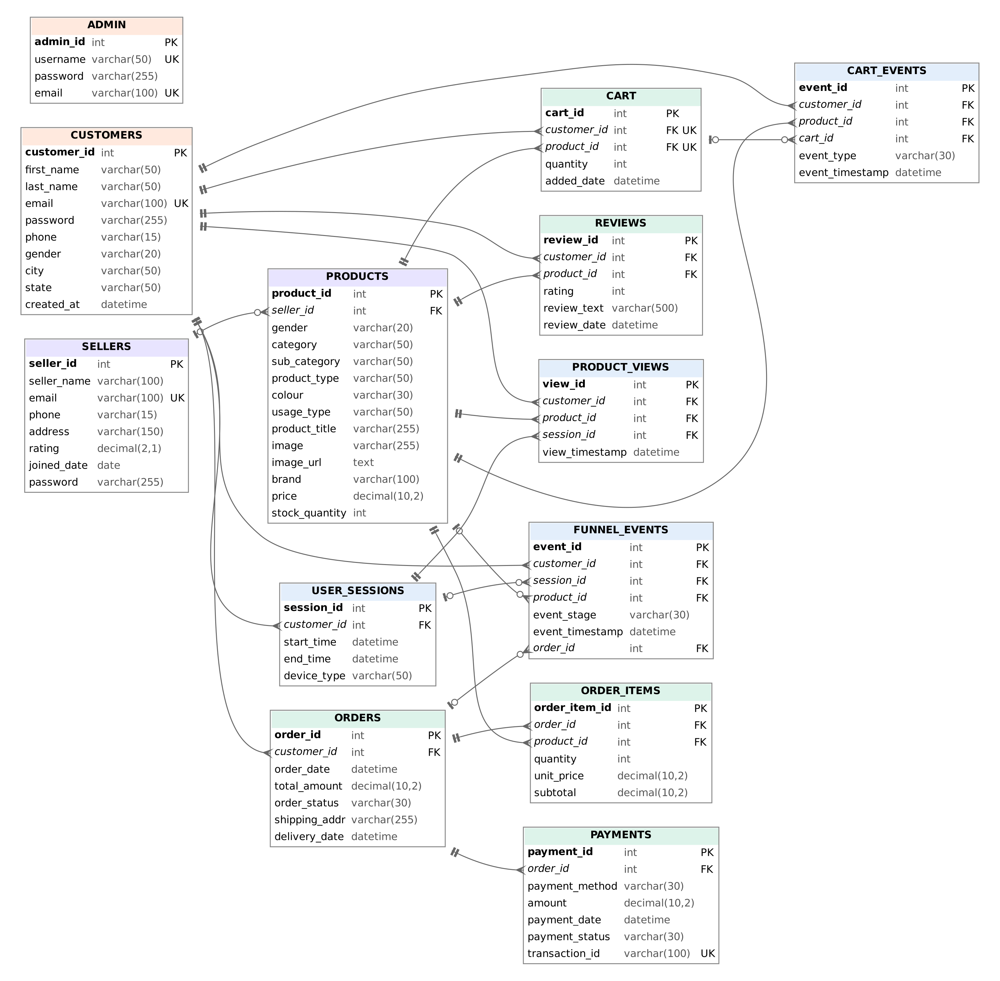

The same relationships as a Mermaid diagram, which GitHub draws:

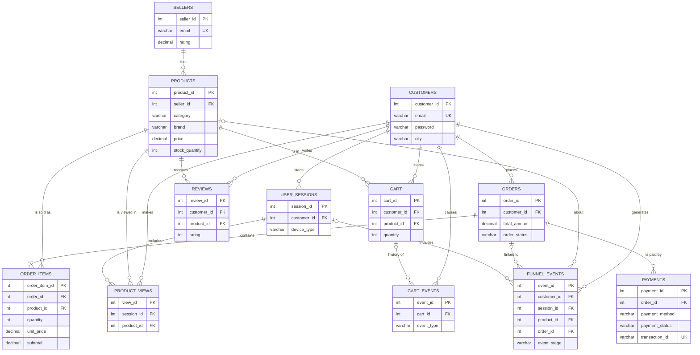

`ADMIN` is a standalone table with no relationships. Django adds its own `auth_*` and `django_*` tables for logins and sessions.

### UML use-case diagram

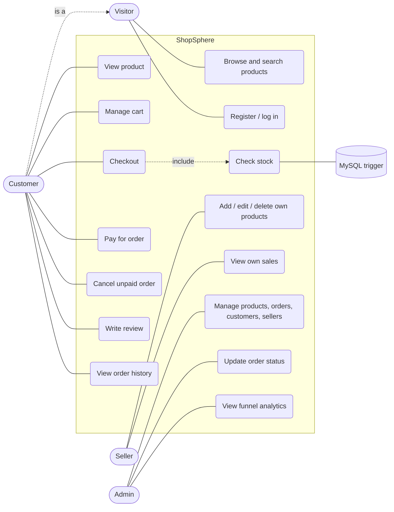

A Customer is a Visitor who has logged in, so a customer can also browse and search. Checkout always includes the stock check, which runs inside MySQL as a trigger.

### UML class diagram (Django models)

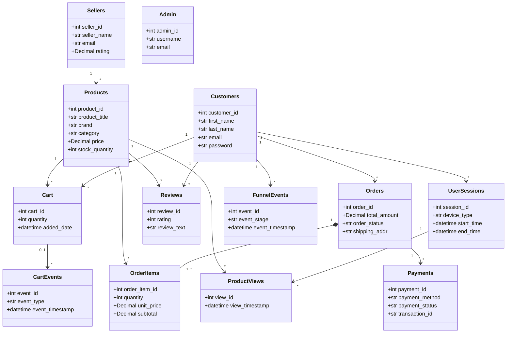

### UML sequence diagram: checkout and payment

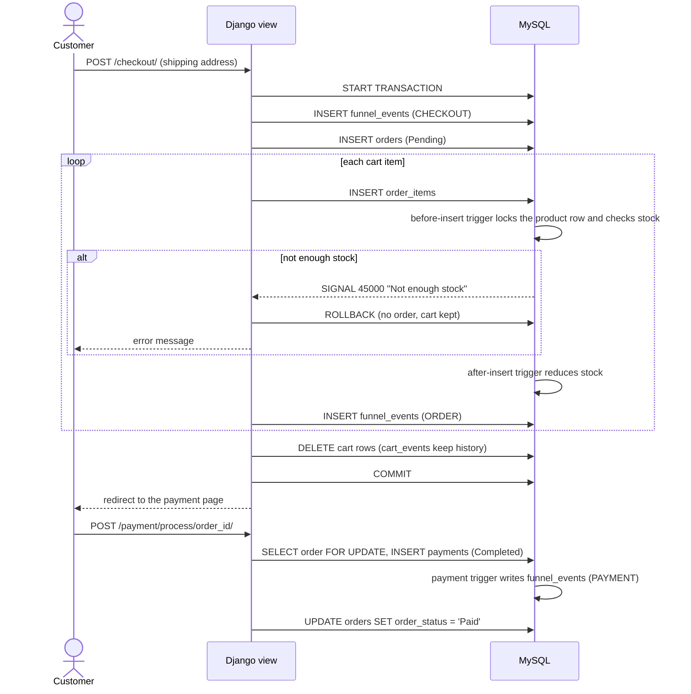

---

## 6. Relational schema mapping

**Bold** is the primary key and *italic* is a foreign key. Each foreign key shows its target table and its delete rule.

- **ADMIN**(**admin_id**, username, password, email)
- **SELLERS**(**seller_id**, seller_name, email, phone, address, rating, joined_date, password)
- **CUSTOMERS**(**customer_id**, first_name, last_name, email, password, phone, gender, city, state, created_at)
- **PRODUCTS**(**product_id**, *seller_id*, gender, category, sub_category, product_type, colour, usage_type, product_title, image, image_url, brand, price, stock_quantity)
  - *seller_id* → SELLERS (RESTRICT)
- **USER_SESSIONS**(**session_id**, *customer_id*, start_time, end_time, device_type)
  - *customer_id* → CUSTOMERS (CASCADE)
- **PRODUCT_VIEWS**(**view_id**, *customer_id*, *product_id*, *session_id*, view_timestamp)
  - *customer_id* → CUSTOMERS (CASCADE)
  - *product_id* → PRODUCTS (RESTRICT)
  - *session_id* → USER_SESSIONS (CASCADE)
- **CART**(**cart_id**, *customer_id*, *product_id*, quantity, added_date)
  - *customer_id* → CUSTOMERS (CASCADE)
  - *product_id* → PRODUCTS (CASCADE)
- **CART_EVENTS**(**event_id**, *customer_id*, *product_id*, *cart_id*, event_type, event_timestamp)
  - *customer_id* → CUSTOMERS (CASCADE)
  - *product_id* → PRODUCTS (RESTRICT)
  - *cart_id* → CART (SET NULL)
- **ORDERS**(**order_id**, *customer_id*, order_date, total_amount, order_status, shipping_addr, delivery_date)
  - *customer_id* → CUSTOMERS (RESTRICT)
- **ORDER_ITEMS**(**order_item_id**, *order_id*, *product_id*, quantity, unit_price, subtotal)
  - *order_id* → ORDERS (CASCADE)
  - *product_id* → PRODUCTS (RESTRICT)
- **PAYMENTS**(**payment_id**, *order_id*, payment_method, amount, payment_date, payment_status, transaction_id)
  - *order_id* → ORDERS (CASCADE)
- **REVIEWS**(**review_id**, *customer_id*, *product_id*, rating, review_text, review_date)
  - *customer_id* → CUSTOMERS (CASCADE)
  - *product_id* → PRODUCTS (CASCADE)
- **FUNNEL_EVENTS**(**event_id**, *customer_id*, *session_id*, *product_id*, event_stage, event_timestamp, *order_id*)
  - *customer_id* → CUSTOMERS (CASCADE)
  - *session_id* → USER_SESSIONS, *product_id* → PRODUCTS, *order_id* → ORDERS (all SET NULL)

**Alternate keys (UNIQUE):** SELLERS.email, CUSTOMERS.email, ADMIN.username, ADMIN.email, CART(customer_id, product_id), PAYMENTS.transaction_id.

**Why these delete rules.**

- **CASCADE** is used for rows that only exist because of their parent, such as a customer's sessions and cart, or an order's items and payments.
- **RESTRICT** protects business history. An order cannot lose its customer, and a product that was sold or viewed cannot be deleted. The app takes such a product off sale instead (stock = 0).
- **SET NULL** keeps analytics history when an optional link disappears.

Every table, with its attribute types, keys and sample records, is listed in section 9 of the [report](docs/ShopSphere_DBMS_Project_Report.pdf).

---

## 7. Normalization and functional dependencies

Every table is in **BCNF** except for one stored derived column, `order_items.subtotal`. It is kept on purpose and guarded by a CHECK constraint. In every other table, the left side of each functional dependency (FD) is a candidate key.

### Worked example: from one order sheet to 3NF

Start from a flat sheet of orders as a shop might keep it:

`ORDER_SHEET(order_id, order_date, customer_id, customer_name, city, {product_id, title, brand, price, quantity})`

1. **1NF.** The product list in braces is a repeating group. Moving it out gives one row per order line, with key (order_id, product_id).
2. **2NF.** With that composite key, some columns depend on only part of the key:
   - `order_date, customer_id, customer_name, city` depend on `order_id` alone;
   - `title, brand, price` depend on `product_id` alone.

   Splitting out these partial dependencies gives ORDERS, PRODUCTS and ORDER_ITEMS(order_id, product_id, quantity, unit_price).
3. **3NF.** In ORDERS, `customer_id → customer_name, city` is a transitive dependency (order_id → customer_id → name). Moving it out gives CUSTOMERS. The same step takes seller details out of PRODUCTS into SELLERS.

The result is exactly the design used: `customers`, `orders`, `order_items`, `products` and `sellers`.

### Functional dependencies per table

| Table | Functional dependencies | Candidate keys | Normal form |
|---|---|---|---|
| sellers | seller_id → all; email → all | seller_id, email | BCNF |
| products | product_id → seller_id, gender, category, sub_category, product_type, colour, usage_type, product_title, image, image_url, brand, price, stock_quantity | product_id | BCNF |
| customers | customer_id → all; email → all | customer_id, email | BCNF |
| admin | admin_id → all; username → all; email → all | admin_id, username, email | BCNF |
| cart | cart_id → all; (customer_id, product_id) → cart_id, quantity, added_date | cart_id, (customer_id, product_id) | BCNF |
| orders | order_id → customer_id, order_date, total_amount, order_status, shipping_addr, delivery_date | order_id | BCNF |
| order_items | order_item_id → order_id, product_id, quantity, unit_price, subtotal; (quantity, unit_price) → subtotal | order_item_id | 2NF (by design) |
| payments | payment_id → all; transaction_id → all | payment_id, transaction_id | BCNF |
| reviews | review_id → customer_id, product_id, rating, review_text, review_date | review_id | BCNF |
| user_sessions | session_id → customer_id, start_time, end_time, device_type | session_id | BCNF |
| product_views | view_id → customer_id, product_id, session_id, view_timestamp | view_id | BCNF |
| cart_events | event_id → customer_id, product_id, cart_id, event_type, event_timestamp | event_id | BCNF |
| funnel_events | event_id → customer_id, session_id, product_id, event_stage, event_timestamp, order_id | event_id | BCNF |

### Deliberate denormalization

- **`order_items.subtotal`** depends on `quantity` and `unit_price`, which are not keys, so the table is strictly 2NF. It is stored so reports do not recompute it. The CHECK `subtotal = quantity * unit_price` makes an inconsistent value impossible.
- **`orders.total_amount`** repeats the sum of the order's items. The clean-up script (06) recalculated it, and the views read the item rows.
- **`order_items.unit_price`** is *not* redundant with `products.price`. It records the price at the moment of purchase, which later price changes must not alter.
- **`funnel_events`** repeats facts recorded elsewhere (views, carts, orders). It is an append-only event log designed for fast analysis, which is the usual practice for event data.

---

## 8. Methodology

1. **Requirements.** We studied a shopping funnel: which customer actions matter, what the store wants to measure (conversion, drop-off, abandonment) and who uses the system (customer, seller, admin). This was presented in the zeroth review.
2. **Data.** We loaded a real fashion catalogue into `products` and `sellers`: `datasets/products.csv`, `sellers.csv`, product photos and a data dictionary.
3. **Conceptual design.** We identified 13 entities and their relationships (ER diagram, section 5).
4. **Logical design and normalization.** We mapped the ER model to tables (section 6) and checked every table against its functional dependencies (section 7).
5. **Physical design.** We wrote the DDL (`database/01`, `03`, `06`, `09`) with:
   - primary keys, and foreign keys with delete rules;
   - CHECK and UNIQUE constraints, and defaults;
   - indexes on the columns the funnel queries filter by.
6. **Business rules in the database.**
   - Triggers check and reduce stock, and record the PAYMENT and REVIEW stages (`04`).
   - Checkout, payment and cancellation run as transactions.
7. **Analytics.** The cumulative funnel rule (a customer who reached a later stage counts in every earlier one) is implemented with views and stored procedures (`05`, `07`, `08`).
8. **Application.** A Django web app serves the three roles. It connects through PyMySQL with parameterised queries.
9. **Demo data.** `generate_funnel_data` creates realistic shoppers so the funnel has numbers to analyse: sessions on different devices, views, carts, orders, payments and reviews.
10. **Testing.** 29 automated Django tests, 16 SQL validation tests and a manual test checklist (section 15).

---

## 9. Advanced SQL: constraints, triggers, views, procedures, transactions

All of it lives in the numbered scripts in [database/](database/).

### Constraints: 13 primary keys, 20 foreign keys, 17 CHECK, 6 UNIQUE

| Rule | Where |
|---|---|
| Quantity above 0; price, stock and totals 0 or more | cart, order_items, products, orders, payments |
| `subtotal = quantity × unit_price` | order_items |
| Rating 1 to 5; seller rating 0 to 5 | reviews, sellers |
| Only valid order statuses: Pending, Paid, Shipped, Delivered, Cancelled | orders |
| Only valid payment statuses: Pending, Completed, Failed, Refunded | payments |
| Only valid funnel stages and cart event types | funnel_events, cart_events |
| Email must look like an email; gender from a fixed list | customers, sellers |
| One cart row per customer and product; unique transaction ids, emails and admin usernames | cart, payments, customers, sellers, admin |
| `ON DELETE CASCADE / SET NULL / RESTRICT` | every foreign key (section 6) |

### Triggers (`database/04_triggers.sql`)

| Trigger | When | What it does |
|---|---|---|
| `trg_order_items_before_insert` | before an order line is saved | Locks the product row (`SELECT … FOR UPDATE`) and raises `SIGNAL SQLSTATE '45000'` if stock is too low |
| `trg_order_items_after_insert` | after an order line is saved | Reduces `products.stock_quantity` |
| `trg_payments_after_insert` | after a successful payment | Writes a PAYMENT funnel event for each product in the order |
| `trg_reviews_after_insert` | after a review | Writes a REVIEW funnel event |

### Views (`database/05`, `07`, `08`)

| View | Answers |
|---|---|
| `vw_funnel_summary` | Customers per stage, % from the previous stage and % of visitors |
| `vw_customer_product_reach` | Furthest stage each customer reached for each product (helper for the views below) |
| `vw_product_funnel` | Funnel per product, view → paid % |
| `vw_category_funnel` | Funnel per gender, category and sub-category |
| `vw_brand_funnel` | Funnel per brand |
| `vw_daily_funnel` | Customers per stage per day |
| `vw_device_funnel` | Sessions and cart → order % per device |
| `vw_cart_abandonment` | Products carted and never paid, with hours since carting |
| `vw_seller_sales` | Units sold and revenue per seller (paid orders) |

### Stored procedures

```sql
CALL sp_funnel_between('2026-09-15', '2026-10-14');  -- funnel for any date range (used by the Analytics page)
CALL sp_customer_journey(13);                        -- one customer's steps in time order
CALL sp_top_products(10);                            -- best sellers by revenue
```

### Cumulative funnel rule

A customer who reached a later stage also counts in every earlier one (VIEW ≥ CART ≥ CHECKOUT ≥ ORDER ≥ PAYMENT), because nobody can pay without viewing and carting. In SQL:

```sql
SELECT customer_id,
       MAX(FIELD(event_stage, 'VIEW','CART','CHECKOUT','ORDER','PAYMENT')) AS max_rank
FROM funnel_events
GROUP BY customer_id;
-- a stage with rank k counts every customer whose max_rank >= k
```

### Transactions

- **Checkout** runs in one `transaction.atomic()` block covering the funnel events, the order, its lines and emptying the cart. If the stock trigger refuses any line, everything rolls back and the shopper sees "Not enough stock for …".
- **Payment** locks the order row (`SELECT … FOR UPDATE`), so a double click cannot pay twice.
- **Cancelling** returns the stock and marks the payment Refunded in one transaction.

---

## 10. Complex queries and their purpose

[database/queries/complex_queries.sql](database/queries/complex_queries.sql) has 24 documented, read-only queries. Each one states its purpose and the SQL concepts it shows. Their output on the demo data is in [docs/sample_outputs/complex_queries_output.txt](docs/sample_outputs/complex_queries_output.txt).

| # | Query | SQL concepts |
|---|---|---|
| Q1 | Full order report (customer, product, seller, payment) | 5-table JOIN, LEFT JOIN |
| Q2 | Current carts and their value | 3-table JOIN, computed column |
| Q3 | One customer's browsing history by session | 3-table JOIN |
| Q4 | Products never viewed | LEFT JOIN … IS NULL (anti-join) |
| Q5 | Revenue, units and orders per seller | GROUP BY, SUM, COUNT(DISTINCT), AVG |
| Q6 | Catalogue summary per gender and category | GROUP BY two columns, MIN / MAX / AVG |
| Q7 | Best-rated brands with at least 2 reviews | GROUP BY + HAVING |
| Q8 | Customers who spent more than 5,000 | HAVING SUM(…) |
| Q9 | Products dearer than their category average | correlated subquery |
| Q10 | Carted but never ordered | IN + NOT EXISTS |
| Q11 | Orders above the average order value | scalar subquery |
| Q12 | Sessions, views and orders per customer | subqueries in SELECT |
| Q13 | Top brand per category | derived tables |
| Q14 | Paid orders not yet reviewed | EXISTS + NOT EXISTS |
| Q15 | **The funnel: conversion and drop-off per stage** | CTE, FIELD(), LAG(), FIRST_VALUE() |
| Q16 | Top 3 products per category | RANK() OVER (PARTITION BY …) |
| Q17 | Daily revenue, running total, 7-day average | SUM() OVER, AVG() OVER (ROWS …) |
| Q18 | Minutes from first view to first payment | conditional aggregation, TIMESTAMPDIFF |
| Q19 | One activity feed from three tables | UNION ALL |
| Q20 | Customer spend segments | CASE, LEFT JOIN + COALESCE |
| Q21–Q24 | Funnel, devices, date range, top products, customer journey | views and stored procedures |

Example (Q15), the core analysis of the project:

```sql
WITH reach AS (
    SELECT customer_id,
           MAX(FIELD(event_stage, 'VIEW','CART','CHECKOUT','ORDER','PAYMENT')) AS max_rank
    FROM funnel_events GROUP BY customer_id
),
stages AS (
    SELECT 1 AS pos, 'VIEW' AS stage UNION ALL SELECT 2, 'CART' UNION ALL
    SELECT 3, 'CHECKOUT' UNION ALL SELECT 4, 'ORDER' UNION ALL SELECT 5, 'PAYMENT'
),
counts AS (
    SELECT s.pos, s.stage, COUNT(r.customer_id) AS customers
    FROM stages s LEFT JOIN reach r ON r.max_rank >= s.pos
    GROUP BY s.pos, s.stage
)
SELECT stage, customers,
       ROUND(100 * customers / NULLIF(LAG(customers) OVER (ORDER BY pos), 0), 1)       AS conversion_pct,
       ROUND(100 - 100 * customers / NULLIF(LAG(customers) OVER (ORDER BY pos), 0), 1) AS drop_off_pct
FROM counts ORDER BY pos;
```

Result on the demo data:

| stage | customers | conversion_pct | drop_off_pct |
|---|---|---|---|
| VIEW | 201 | | |
| CART | 115 | 57.2 | 42.8 |
| CHECKOUT | 71 | 61.7 | 38.3 |
| ORDER | 71 | 100.0 | 0.0 |
| PAYMENT | 64 | 90.1 | 9.9 |

---

## 11. Repository structure

```
E-commerce-project/
├── README.md                      this file
├── requirements.txt               Python packages
├── manage.py                      Django entry point
│
├── database/                      CORE DBMS ASSETS (run in numeric order)
│   ├── 00_create_app_user.sql     optional: a MySQL login just for the website
│   ├── 01_schema.sql              DDL: 12 core tables with PK / FK (ON DELETE rules) / UNIQUE / CHECK
│   ├── 02_seed_catalog.sql        16 sellers + 2,905 products
│   ├── 03_funnel_events.sql       funnel_events table + indexes (+ backfill from old data)
│   ├── 04_triggers.sql            4 triggers
│   ├── 05_views_procedures.sql    views + 3 stored procedures
│   ├── 06_constraints_cleanup.sql data clean-up + CHECK / UNIQUE constraints
│   ├── 07_device_view.sql         device funnel view
│   ├── 08_cumulative_funnel.sql   cumulative funnel views + date-range procedure
│   ├── 09_delete_rules.sql        ON DELETE CASCADE / SET NULL for an existing database
│   ├── queries/complex_queries.sql  24 documented complex queries
│   └── tests/validation_tests.sql   16 PASS / FAIL tests of constraints, triggers and delete rules
│
├── config/                        BACKEND: Django project settings
│   ├── settings.py                database connection, connection reuse, test runner
│   ├── urls.py                    all page URLs
│   └── local_settings.example.py  copy to local_settings.py with your MySQL password
│
├── store/                         BACKEND + FRONTEND: the shop application
│   ├── models.py                  one model per table (managed = False: tables come from database/)
│   ├── views.py                   customer, seller, admin and analytics pages
│   ├── tests.py                   29 automated tests
│   ├── test_runner.py, sql_scripts.py   build the test database from database/*.sql
│   ├── management/commands/       create_sample_data, generate_funnel_data,
│   │                              hash_plain_passwords, set_seller_password
│   ├── templates/store/           FRONTEND: HTML pages and shared partials
│   └── static/store/              FRONTEND: css/site.css, js/site.js, js/chart.umd.min.js
│
├── datasets/                      products.csv, sellers.csv, DataDictionary.xlsx, product photos
│
└── docs/
    ├── ShopSphere_DBMS_Project_Report.pdf
    ├── er_diagram.png, er_diagram.dot
    ├── TEST_CASES.md              manual test cases
    ├── screenshots/               14 screenshots of the running app
    └── sample_outputs/            query, SQL test and Django test outputs
```

The course guidelines give Flask/FastAPI or Node.js as backend examples. This project uses **Django**, a Python web framework that plays the same role.

---

## 12. Installation and setup

### Step 1: Get the code

```bash
git clone https://github.com/Bhavesh-max-jpj/E-commerce-project.git
cd E-commerce-project
```

### Step 2: Install the Python packages

```bash
pip install -r requirements.txt
```

On Windows, if `pip` is not found, use `py -m pip install -r requirements.txt`.

### Step 3: Create and populate the database

Open **MySQL Workbench** and connect as `root`. Then run each script below in order:

1. Choose **File → Open SQL Script** and pick the script.
2. Click **Execute All** (the lightning bolt, or Ctrl+Shift+Enter).

| Order | Script | Creates |
|---|---|---|
| 1 | `database/01_schema.sql` | database `shopping_funnel` + 12 tables (**drops existing ones**) |
| 2 | `database/02_seed_catalog.sql` | 16 sellers, 2,905 products |
| 3 | `database/03_funnel_events.sql` | `funnel_events` table + indexes |
| 4 | `database/04_triggers.sql` | 4 triggers |
| 5 | `database/05_views_procedures.sql` | views + 3 stored procedures |
| 6 | `database/06_constraints_cleanup.sql` | CHECK / UNIQUE constraints |
| 7 | `database/07_device_view.sql` | device funnel view |
| 8 | `database/08_cumulative_funnel.sql` | cumulative funnel views |
| 9 | `database/09_delete_rules.sql` | delete rules (no change on a fresh build) |

You can also run them from a terminal. In Windows PowerShell, inside the project folder:

```powershell
foreach ($f in "01_schema","02_seed_catalog","03_funnel_events","04_triggers","05_views_procedures","06_constraints_cleanup","07_device_view","08_cumulative_funnel","09_delete_rules") {
  Get-Content "database\$f.sql" | mysql -u root -p
}
```

On Linux or macOS:

```bash
for f in 01_schema 02_seed_catalog 03_funnel_events 04_triggers 05_views_procedures \
         06_constraints_cleanup 07_device_view 08_cumulative_funnel 09_delete_rules; do
  mysql -u root -p < database/$f.sql
done
```

> **Already have the database?** Only run the scripts you have not run yet; 03 to 09 are safe to re-run. The old `sql/` folder became `database/`, with new numbers:
>
> | Old name | New name |
> |---|---|
> | `base_schema` | `01_schema` |
> | `base_catalog` | `02_seed_catalog` |
> | `01_funnel_events` | `03_funnel_events` |
> | `02_triggers` | `04_triggers` |
> | `03_views_procedures` | `05_views_procedures` |
> | `04_constraints_cleanup` | `06_constraints_cleanup` |
> | `05_device_view` | `07_device_view` |
> | `06_cumulative_funnel` | `08_cumulative_funnel` |
>
> The only new script is `09_delete_rules.sql`.

### Step 4: Tell Django your MySQL login

Copy `config/local_settings.example.py` to `config/local_settings.py` and put in your password:

```python
DB_USER = "root"
DB_PASSWORD = "your-mysql-password"
```

This file is listed in `.gitignore`, so passwords are never pushed to GitHub. Instead of root, you can also run `database/00_create_app_user.sql` and use the `shop_app` login it creates.

### Step 5: Django tables and test accounts

```bash
python manage.py migrate                 # Django's own login / session tables
python manage.py create_sample_data      # test customer, seller and admin
python manage.py hash_plain_passwords    # hashes any plain-text passwords
python manage.py generate_funnel_data    # optional: 300 demo shoppers for the analytics
```

---

## 13. Running the application

```bash
python manage.py runserver
```

Open <http://127.0.0.1:8000/> in a browser. To stop the server, press **Ctrl+C** in the terminal.

In **VS Code**: choose File → Open Folder and pick the project folder. Then choose Terminal → New Terminal and run the command above.

| Role | Login page | Email / username | Password |
|---|---|---|---|
| Customer | <http://127.0.0.1:8000/login/> | `customer@example.com` | `pass123` |
| Seller | <http://127.0.0.1:8000/seller/login/> | `seller@example.com` | `pass123` |
| Admin | <http://127.0.0.1:8000/adminpanel/login/> | `admin` | `adminpass` |
| Demo shoppers | <http://127.0.0.1:8000/login/> | `<name>@demo.shop` | `demo1234` |

The test seller has no products. To log in as a catalogue seller that has products and sales (for example TrendStyle Fashion), give it a password first:

```bash
python manage.py set_seller_password trendstyle@gmail.com pass123
```

**Troubleshooting**

| Message | Fix |
|---|---|
| `Access denied for user 'root'` | The password in `config/local_settings.py` is wrong |
| `Can't connect to MySQL server` | Start MySQL (Windows Services → MySQL80, or open Workbench) |
| `Table / view … doesn't exist` | A script in `database/` was not run; run the missing ones in order |
| `Error 1175` (safe update mode) in Workbench | The scripts turn safe mode off themselves; run the whole script with Execute All |

---

## 14. Demonstration: reproduce the database state and results

Follow these steps to rebuild the database and reproduce the numbers in the report from scratch.

1. **Build the database.** Run `database/01` to `09` (section 12, step 3).
2. **Create the accounts and demo data.**
   ```bash
   python manage.py migrate
   python manage.py create_sample_data
   python manage.py generate_funnel_data
   ```
   `generate_funnel_data` creates 300 shoppers over 30 days, with sessions on mobile, desktop and tablet, product views, cart changes, orders, payments and reviews. It always uses the same random seed (42), so every run produces the same data. To remove the demo data later (stock is given back), run `python manage.py generate_funnel_data --delete`.
3. **Start the site** with `python manage.py runserver`.
4. **Walk through the funnel as a customer.** Log in as `customer@example.com`, then:
   1. Open any product. This records **VIEW**.
   2. Click **Add to cart**. This records **CART**.
   3. Open the cart, click **Checkout** and enter an address. This records **CHECKOUT** and **ORDER**, and the trigger reduces the stock.
   4. Pay with any method. The payment trigger records **PAYMENT** and the order becomes **Paid**.
   5. Go back to the product and write a review. The review trigger records **REVIEW**.
5. **See it in the database.** Run this in Workbench:
   ```sql
   USE shopping_funnel;
   SET @c := (SELECT customer_id FROM customers WHERE email = 'customer@example.com');
   CALL sp_customer_journey(@c);
   SELECT * FROM vw_funnel_summary;
   ```
6. **See the analytics as admin.**
   - **Analytics** shows the funnel for a date range (using `sp_funnel_between`), the daily trend, devices, categories and abandoned carts.
   - **Funnel table** shows the overall funnel and per-product funnels.
7. **Show the stock trigger refusing an order.**
   1. In Workbench, set a product's stock to 1.
   2. As the customer, add 2 of that product to the cart and check out.
   3. The site shows "Not enough stock …" and no order is created, because the transaction rolled back.
8. **Run the complex queries.** Open `database/queries/complex_queries.sql` and run it, then compare with `docs/sample_outputs/complex_queries_output.txt`.
9. **Run the tests** (section 15).

Your exact numbers will differ slightly from the report, because they change as you shop on the site. The shape of the funnel stays the same: the largest drop is VIEW → CART, and mobile converts worse than desktop.

---

## 15. Testing and validation

### A. Automated application tests (29 tests)

```bash
python manage.py test store -v 2
```

The test runner builds a **separate** database, `test_shopping_funnel`, from `database/01` to `09`. The tests therefore run against the real tables, constraints, triggers, views and procedures. Your `shopping_funnel` data is never touched, and the test database is deleted afterwards. The MySQL login needs permission to create a database (root has it).

| Group | What is checked |
|---|---|
| Database build | The catalogue is loaded; the 4 triggers, 9 views and 3 procedures exist |
| Constraints | Rating 1–5, cart quantity > 0, unique email, valid order status, foreign key |
| Accounts and security | Registration hashes the password; an invalid or duplicate email is refused; a wrong password is refused; login creates a session; protected pages redirect to login; `next` cannot send users to another site; a customer cannot open admin pages |
| Funnel flow | Public pages load; search is safe from SQL injection; VIEW, CART, CHECKOUT, ORDER, PAYMENT and REVIEW are recorded; checkout reduces stock; checkout rolls back when stock runs out; an order cannot be paid twice, or paid by another customer; cancelling returns stock; the funnel never widens |
| Seller and admin | A seller adds a product; every admin page loads; order status can only move Paid → Shipped → Delivered |

Result: [docs/sample_outputs/django_tests_output.txt](docs/sample_outputs/django_tests_output.txt) (29 of 29 passed).

### B. SQL validation tests (16 tests)

Open [database/tests/validation_tests.sql](database/tests/validation_tests.sql) in Workbench and click Execute All. Inside one transaction, the script tries bad inserts and checks the triggers and delete rules. It then **rolls everything back** and prints a PASS / FAIL table. Result: [docs/sample_outputs/validation_tests_output.txt](docs/sample_outputs/validation_tests_output.txt) (16 of 16 passed).

### C. Manual test cases

[docs/TEST_CASES.md](docs/TEST_CASES.md) lists step-by-step manual tests for every page and role, with the expected result of each.

---

## 16. Screenshots and sample outputs

| | |
|---|---|
| 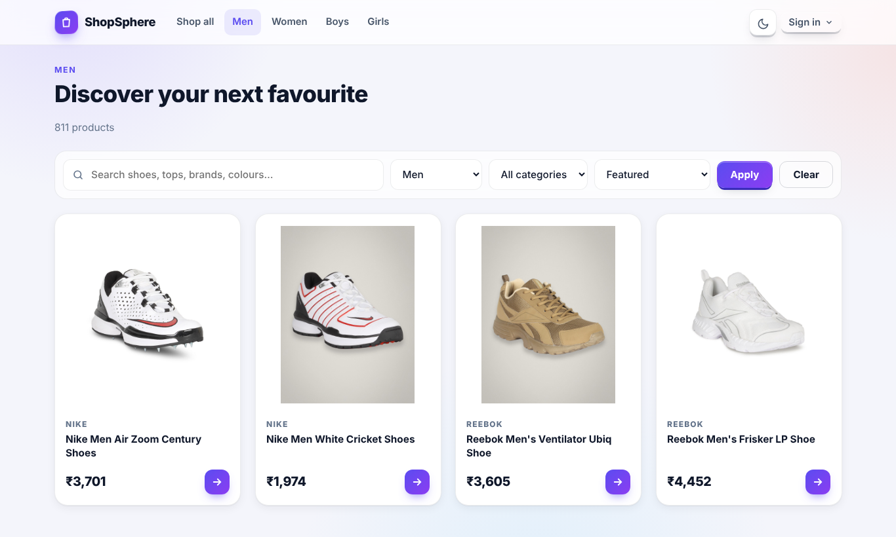 Product listing with search, filters and sort | 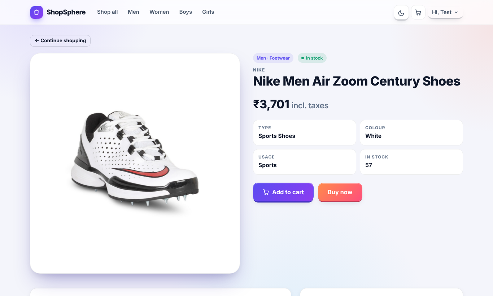 Product page (records VIEW) |
| 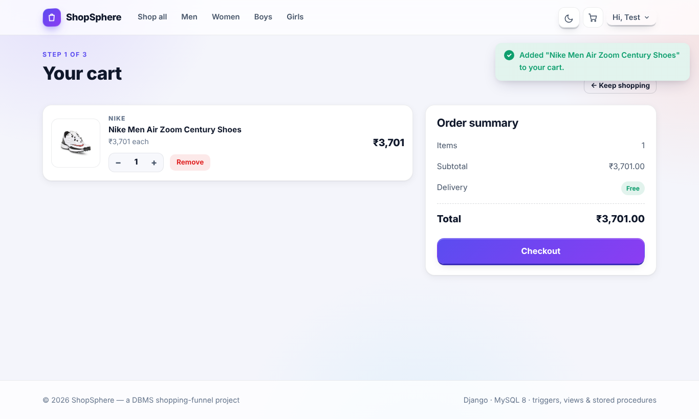 Cart (records CART) | 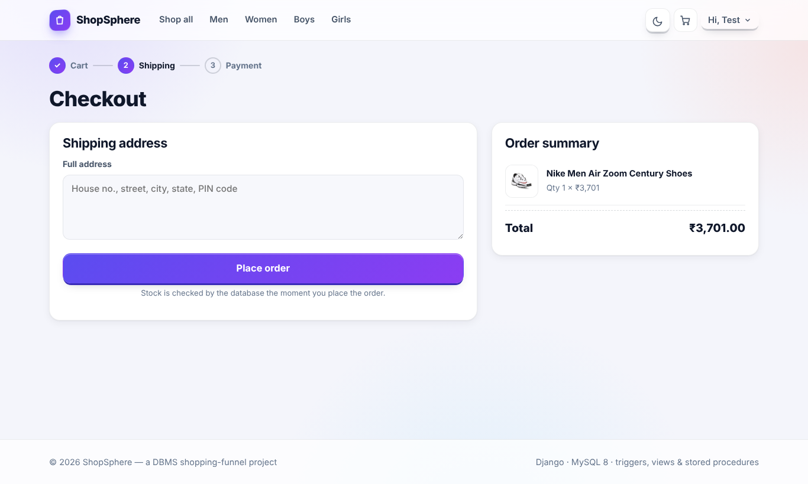 Checkout |
| 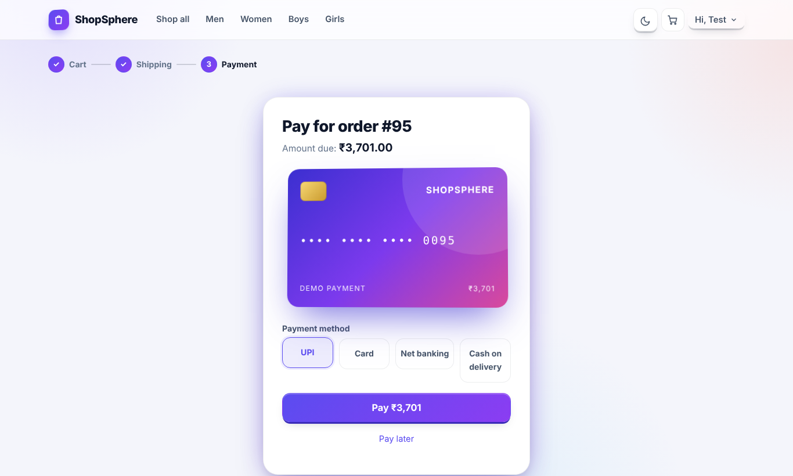 Simulated payment | 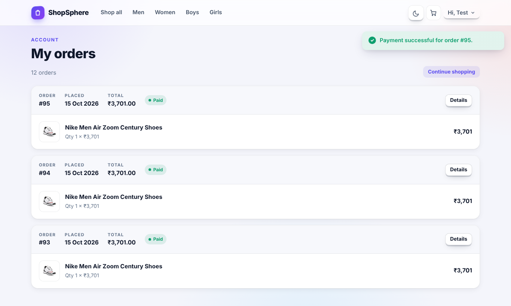 Order history |
| 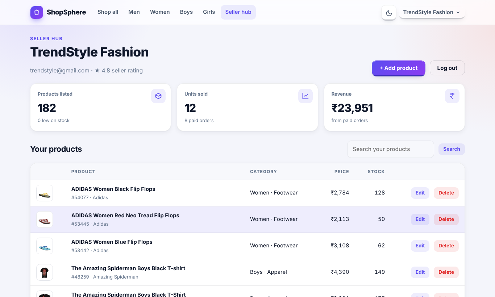 Seller hub with sales from `vw_seller_sales` | 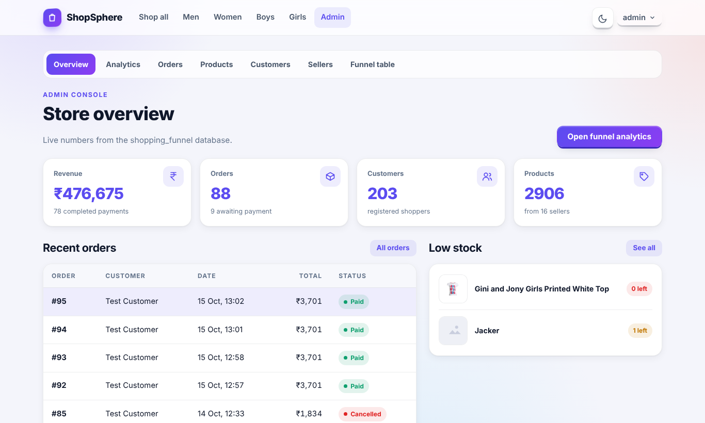 Admin dashboard |
| 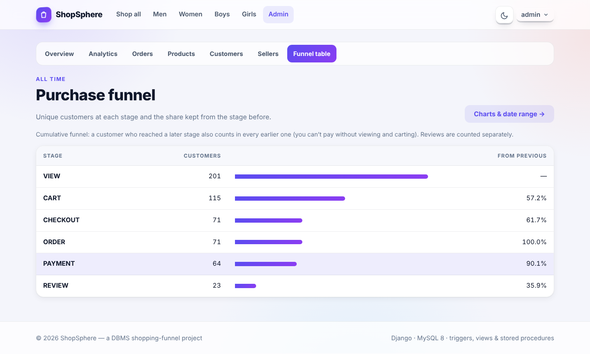 Purchase funnel from `vw_funnel_summary` | 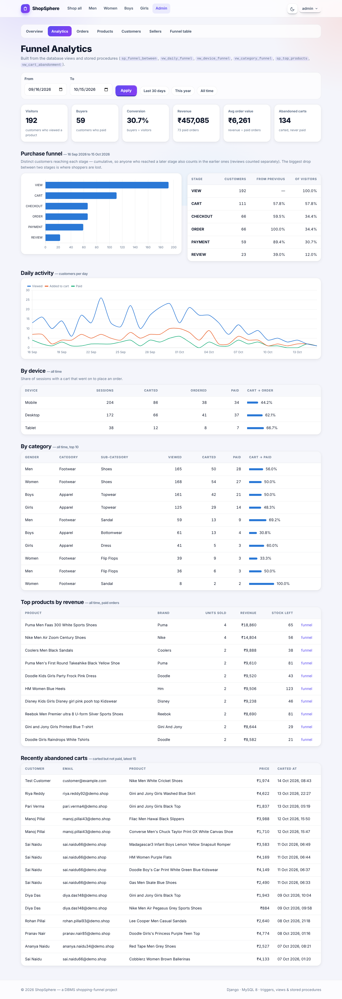 Analytics: date-range funnel, daily trend, devices, categories |

All screenshots are in [docs/screenshots/](docs/screenshots/).

Sample outputs:

- [complex_queries_output.txt](docs/sample_outputs/complex_queries_output.txt): the 24 complex queries
- [validation_tests_output.txt](docs/sample_outputs/validation_tests_output.txt): the SQL tests
- [django_tests_output.txt](docs/sample_outputs/django_tests_output.txt): the application tests

---

## 17. Conclusion and future scope

ShopSphere shows how a database can do more than store data:

- constraints refuse bad values;
- triggers manage stock and record funnel stages;
- transactions keep orders whole;
- views and stored procedures turn raw events into decisions.

On the demo data, the clearest decision is to fix mobile checkout, where carts convert about 16 points worse than on desktop.

**Limitations**

- Payment is simulated; no money moves.
- Views and cart adds are recorded only for logged-in customers, because the funnel needs to know who the shopper is.
- The demo shoppers are generated, so their percentages show how the reports work rather than real market behaviour.

**Future scope**

- Guest carts that merge into the account on login.
- A real payment gateway, and email notifications on shipping.
- Seller registration, seller order processing and a per-seller funnel dashboard.
- Product photo upload by sellers.
- Indexes tuned with `EXPLAIN` on larger data, and partitioning `funnel_events` by month.
